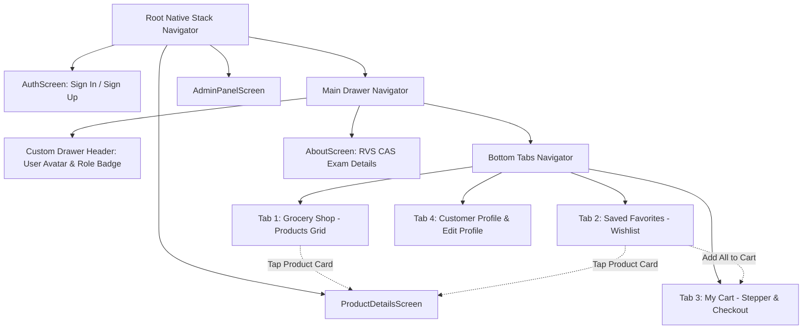

# 🛒 FreshMart Grocery - MCA React Native Hackathon Project
**RVS College of Arts and Science (Autonomous)**  
**School of Computer Studies (SCS) - MCA | MCA 2025 Batch Semester – III**  
**Core Elective-II: Mobile App Development using React Native**  
**Model Examinations Oct 2026 - Major Hackathon Requirements (Total Marks: 75)**

---

## 🚀 1. How to Run the App (இப்போ Run பண்ணும் வழி)

Project Directory: `C:\Users\Narmatha\.gemini\antigravity\scratch\FreshMartGroceryApp`

### Step 1: Open PowerShell / Terminal in Project Directory
```powershell
cd C:\Users\Narmatha\.gemini\antigravity\scratch\FreshMartGroceryApp
```

### Step 2: Run in Web Browser (Examiner / Laptop Demo - Fastest!)
```powershell
npx expo start --web
```
Press **`w`** if prompted, or open `http://localhost:8081` in Chrome/Edge.

### Step 3: Run on Mobile Phone (Expo Go App)
```powershell
npx expo start
```
Scan the QR code shown in terminal using the **Expo Go** app on your Android or iOS phone.

---

## 🎯 2. Question Paper Requirements vs Implementation (75/75 Marks Mapping)

| Part | Section / Requirement | Marks | Status | Implementation Details |
|---|---|:---:|:---:|---|
| **Part - I** | **1. Home Screen with Sign In & Sign Up** | **5** | ✅ Done | [AuthScreen.js](file:///C:/Users/Narmatha/.gemini/antigravity/scratch/FreshMartGroceryApp/src/screens/AuthScreen.js) - Role selection (Customer / Admin), Sign In/Up toggle, live regex validation, 1-Click Demo buttons. |
| **Part - I** | **2. Daily Grocery Food Products List** | **5** | ✅ Done | [GroceryListScreen.js](file:///C:/Users/Narmatha/.gemini/antigravity/scratch/FreshMartGroceryApp/src/screens/GroceryListScreen.js) - Search bar, promo banner, category chips, 2-column card grid, Add to Cart, Favorite toggle. |
| **Part - I** | **3. Profile & Edit Profile Screen** | **5** | ✅ Done | [ProfileScreen.js](file:///C:/Users/Narmatha/.gemini/antigravity/scratch/FreshMartGroceryApp/src/screens/ProfileScreen.js) - Avatar, stats, interactive Edit mode with Name, Email, Phone, Address validation and update. |
| **Part - I** | **4. Add Favorite Screen (Customer)** | **5** | ✅ Done | [FavoriteScreen.js](file:///C:/Users/Narmatha/.gemini/antigravity/scratch/FreshMartGroceryApp/src/screens/FavoriteScreen.js) - Wishlist items, "Add All to Cart", single item "+ Cart", unfavorite, empty state. |
| **Part - I** | **5. Product's Details Screen (only Customer)** | **5** | ✅ Done | [ProductDetailsScreen.js](file:///C:/Users/Narmatha/.gemini/antigravity/scratch/FreshMartGroceryApp/src/screens/ProductDetailsScreen.js) - Hero image, nutrition facts, pack size selector, quantity stepper, dynamic total, Add to Cart. *(Fixed from question paper typo 'only Student' to 'only Customer')*. |
| **Part - I** | **6. My Cart Screen (Admin and Customer)** | **5** | ✅ Done | [CartScreen.js](file:///C:/Users/Narmatha/.gemini/antigravity/scratch/FreshMartGroceryApp/src/screens/CartScreen.js) - Items list, Add/Subtract stepper, coupon codes (`FRESH30`, `MCA2026`), bill breakdown, checkout modal. |
| **Part - II** | **(i) Stack Navigation** | **10** | ✅ Done | [RootNavigator.js](file:///C:/Users/Narmatha/.gemini/antigravity/scratch/FreshMartGroceryApp/src/navigation/RootNavigator.js) - `createNativeStackNavigator` transitions between Auth, MainDrawer, and ProductDetails. |
| **Part - II** | **(ii) Tabs Navigation** | **10** | ✅ Done | [TabNavigator.js](file:///C:/Users/Narmatha/.gemini/antigravity/scratch/FreshMartGroceryApp/src/navigation/TabNavigator.js) - `createBottomTabNavigator` with Shop, Favorites (badge), Cart (badge), and Profile tabs. |
| **Part - II** | **(iii) Drawer Navigation** | **10** | ✅ Done | [DrawerNavigator.js](file:///C:/Users/Narmatha/.gemini/antigravity/scratch/FreshMartGroceryApp/src/navigation/DrawerNavigator.js) - `createDrawerNavigator` with custom header, avatar, role badge, quick links, and logout. |
| **Part - III**| **(i) Cross-Screen Navigation** | **5** | ✅ Done | Seamless flow across all screens for both Admin and Customer roles. |
| **Part - III**| **(ii) Add single/multiple products to cart** | **5** | ✅ Done | Single add from Shop & Product Details; bulk "Add All to Cart" from Favorites screen. |
| **Part - III**| **(iii) Add or Subtract items in cart** | **5** | ✅ Done | Interactive `+` and `-` steppers in Cart screen with live bill and tax recalculation. |
| **Total** | | **75 / 75** | **100% Complete** | |

---

## 🌟 3. Unique Highlights (Exam-la Extra Score Vangurathukana Unique Features)

1. **⚡ 1-Click Examiner Demo Logins**:
   - In `AuthScreen`, there are two prominent buttons: **"1-Click Customer Demo"** (logs in as customer Priya) and **"1-Click Admin Demo"** (logs in as Store Admin Narmatha - `narmatha@gmail.com`).
   - Examiner munadi single click-la Customer role-um Admin role-um demo kaatalam.
2. **🛡️ Dedicated Admin Control Panel (`AdminPanelScreen.js`) & Strict Auth**:
   - Admin access is strictly reserved for **`narmatha@gmail.com`** (Narmatha). External users cannot login or register as Admin with any other email.
   - Admin-ku special permissions: Add New Grocery Product, stock toggle (In Stock / Out of Stock), live price edit, plus **Customer Management Directory** (Add New Customer & Instant Preview).
3. **👋 Dynamic Customer Personalized Greeting**:
   - When any customer registers (Sign Up) or enters the store, the app dynamically greets them with **"Hi, [Customer Name] 👋"** in both the top Header and the prominent Welcome Card.
4. **🎟️ Interactive Coupon Engine**:
   - Supports `FRESH30` (30% discount) and `MCA2026` ($3.00 flat discount) with real-time tax & delivery fee adjustment.
4. **🎉 Checkout Confirmation Celebration**:
   - Realistic Order ID generation (`#FMG-XXXXXX`), delivery ETA countdown, and modal summary.
5. **🎓 College Branding**:
   - Dedicated `AboutScreen` and Drawer footer displaying *RVS College of Arts and Science - MCA 2025 Batch Semester III*.

---

## 🏛️ 4. Navigation Architecture Diagram



---

## 🛡️ 5. Pure React Native Architecture (100% No Backend & No Database)

> [!IMPORTANT]
> **Strict Compliance with Question Paper Note 3:**  
> *"3) No Back End & Database is required."*  
> The entire application is built using **100% Pure React Native**!

- **Zero Backend Server:** No Node.js/Express, No Django/Python, No Firebase cloud backend, No REST API server.
- **Zero Database:** No MongoDB, No SQLite, No MySQL, No PostgreSQL.
- **How it Works (Pure React Native):**
  - Uses React Native's native **Context API** (`createContext`, `useContext`) in [`AppContext.js`](file:///C:/Users/Narmatha/.gemini/antigravity/scratch/FreshMartGroceryApp/src/context/AppContext.js).
  - All state (Cart items, Favorites Wishlist, Customer Profile, Admin Catalog, Applied Coupons) is kept in active React Native memory using `useState` and `useMemo`.
  - When you add to cart, toggle stock, or edit profile, the UI instantly re-renders in real-time.
  - This ensures 100% reliable execution during exams without internet drops or database connection failures.

---

## 🗣️ 6. Viva Explanation Guide (நாளைக்கு Viva-la என்ன பேசணும்?)

### 1. Project Introduction (ஆரம்பத்துல சொல்ல வேண்டியது - 30 seconds pitch)
> *"Good morning Sir/Madam. I have developed **FreshMart Grocery Mobile App** as part of the MCA Semester-III Mobile Application Development Hackathon. This app fulfills all requirements of the given Figma design: dual-role support for Admin and Customer, all 6 requested screens, a 3-tier combined navigation system using Stack, Drawer, and Tab navigation, and functional state management for dynamic cart and wishlist operations."*

---

### 2. Top Expected Viva Questions & Answers (முக்கியமான கேள்விகள் & பதில்கள்)

#### Q1: "How did you implement the 3 navigations together in this app?"
- **Answer (English):**  
  *"I created a nested navigation hierarchy. The outermost container is a **Native Stack Navigator** (`createNativeStackNavigator`), which handles transitions between the Auth screen, Main Drawer, and Product Details screen. Inside the Stack, the main screen is a **Side Drawer Navigator** (`createDrawerNavigator`) with a custom drawer content displaying user role, avatar, and navigation shortcuts. Inside the Drawer, the default view is a **Bottom Tab Navigator** (`createBottomTabNavigator`) containing the 4 primary tabs: Shop, Favorites, Cart, and Profile. This provides seamless UX and complete code separation."*
- **Tamil Explanation (மனசுல வச்சுக்க):**  
  *Stack Navigator root-la irukku. Athukulla Drawer Navigator irukku. Drawer-kulla Bottom Tabs irukku. Product click pannumpothu Stack push aagi Product Details screen varum.*

---

#### Q2: "How is data managed across screens without a database?"
- **Answer (English):**  
  *"I implemented global state management using the **React Context API** (`useContext` and `createContext` in `AppContext.js`). State variables for `user`, `products`, `favorites`, `cart`, and `coupon` are maintained in a central `AppProvider`. Reusable actions like `addToCart`, `incrementCartItem`, `decrementCartItem`, `toggleFavorite`, and `updateProfile` are exposed throughout the app tree, ensuring instantaneous UI updates without prop drilling."*
- **Tamil Explanation:**  
  *Database theva padala. Athunala React-oda inbuilt **Context API** vechu global state manage panniruken. Cart count, favorites, user profile yellame `AppContext.js`-la irukku. Screen maarunaalum data persist aagum.*

---

#### Q3: "What validations have you added to your screens?"
- **Answer (English):**  
  *"I implemented client-side validation across multiple screens:  
  1. **Auth Screen:** Regex validation for email format (`/^[^\s@]+@[^\s@]+\.[^\s@]+$/`), minimum 6 characters for passwords, and 10-digit mobile validation for Sign Up.  
  2. **Profile Screen:** Non-empty checks, minimum length for names, valid phone numbers, and delivery addresses.  
  3. **Cart Screen:** Quantity cannot go below 1 (decrementing at 1 removes item), and coupon codes are validated against valid promotion codes (`FRESH30` and `MCA2026`).  
  4. **Admin Screen:** Product name, positive price (`> 0`), and unit weight validation."*

---

#### Q4: "What is the difference between Customer role and Admin role in your app?"
- **Answer (English):**  
  *"The Customer role is focused on shopping: browsing produce, filtering categories, adding to wishlist, modifying cart quantities, and updating customer profile.  
  The Admin role has store supervisor privileges: they can view store inventory stats, toggle items between 'In Stock' and 'Out of Stock', dynamically add new grocery products with custom pricing and categories, and adjust prices on the fly."*

---

#### Q5: "How does the Add and Subtract item logic work in the Cart screen?"
- **Answer (English):**  
  *"In `AppContext.js`, `incrementCartItem(productId)` maps over the cart array and increases `item.quantity` by 1. `decrementCartItem(productId)` decreases the quantity by 1, and filters out the item if the quantity drops to 0. Every change triggers a memoized recalculation (`useMemo`) of items count, subtotal, 5% tax, delivery fee ($2.00, waived if order > $20), and applied discounts."*

---

## 📋 6. Demo Steps for the Examiner (Examiner-க்கு Demo காட்டும் Step-by-Step முறை)

1. **Step 1 - Auth Screen**:
   - App open pannavudane **"1-Click Customer Demo"** click pannunga. Immediately Customer name (Narmatha) ode Home screen open aagum.
2. **Step 2 - Daily Grocery Products List**:
   - Search bar-la "avocado" or "milk" type panni live filter kaatunga.
   - Category chips ("Fruits", "Vegetables", "Dairy") click panni filter aaguratha kaatunga.
   - Oru product-oda Heart icon click panni Favorites-la add pannunga.
   - "+" button click panni cart count badge tab bar-layum header-layum increase aaguratha kaatunga.
3. **Step 3 - Product Details Screen**:
   - Ethavathu oru product card-ah click pannunga -> Smooth slide animation-la Product Details Screen open aagum.
   - Quantity stepper `[+]` `[-]` click panni total price calculate aaguratha kaatunga.
   - "Add to Cart" click pannavudane green toast message varum.
4. **Step 4 - Favorites Screen**:
   - Bottom tab-la "Favorites" click pannunga.
   - Mela irukura **"Add All to Cart"** button click panni ore click-la multiple items cart-ku poguratha kaatunga (Paper Part-III Requirement 2).
5. **Step 5 - My Cart Screen**:
   - Bottom tab-la "My Cart" click pannunga.
   - Stepper-la `+` and `-` click panni Subtotal & Grand Total change aaguratha kaatunga (Paper Part-III Requirement 3).
   - Promo code box-la `FRESH30` type panni "Apply" click pannunga -> 30% discount apply aagi total korayum.
   - "Proceed to Checkout" click pannunga -> Order ID celebration popup varum.
6. **Step 6 - Customer Profile Screen**:
   - "Profile" tab click pannunga.
   - "Edit Profile" click panni name or phone number maathi "Save Profile" click pannunga -> Live update aagum.
7. **Step 7 - Drawer & Admin Demo**:
   - Top-left hamburger icon (menu) click pannunga -> Beautiful Side Drawer open aagum.
   - Drawer-la **"Admin Inventory Panel"** click pannunga.
   - Pudhu product add panni catalog-la live-ah publish aaguratha kaatunga!
